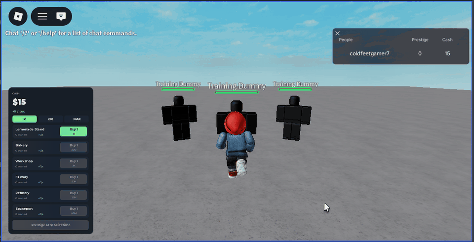
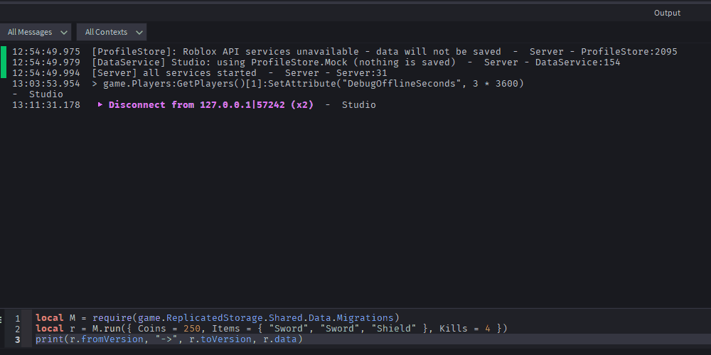
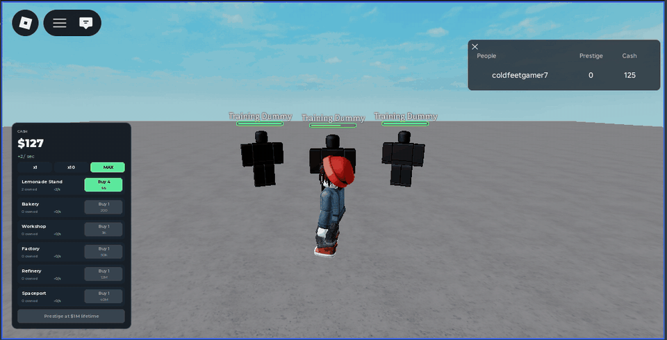

# Roblox Systems

Three production-style Roblox systems in Luau, built with Rojo and tested in CI.

| System | What it shows |
|---|---|
| **Server-authoritative combat** | Validated remotes, rate limiting, server-time cooldowns, combo and finisher, capped latency compensation |
| **ProfileStore data + migrations** | Session locking, atomic versioned migrations, refusal of newer-version data, exactly-once developer products |
| **Idle economy + offline earnings** | Exponential prices with O(1) "buy max", milestones, prestige, 2x boost, clock-safe offline earnings |

**Live demo of the combat rules:** [georgedotdev.github.io](https://georgedotdev.github.io)


<!-- Add the Studio recordings here after you record them (see docs/RECORDING.md):
| Combat | Data | Economy |
|---|---|---|
|  |  |  |
-->

## How it is built

```
src/
  shared/              ReplicatedStorage.Shared — pure logic, no Roblox services
    Combat/            CombatConfig, Guard, RateLimiter, HitValidation
    Data/              Schema, Migrations
    Economy/           EconomyConfig, Economy, NumberFormat
    Net/Remotes.luau   every remote, named in one place
    Util/Signal.luau
  server/              ServerScriptService.Server
    init.server.luau   Init() all services, then Start() all services
    Services/          DataService, EconomyService, ReceiptService, CombatService, PlaygroundService
  client/              StarterPlayerScripts.Client
    Controllers/       CombatController, EconomyController (UI built in code)
tests/                 Lune test runner + 61 unit tests
```

The rule that makes this testable: **game rules live in `src/shared` as pure modules.**
They take plain values and return plain values. Services in `src/server` do the
Roblox work (remotes, DataStores, humanoids) and call the pure modules for every decision.
So the decisions run under Lune in CI, without Studio.

### Combat: the client asks, the server decides

The client fires `CombatRequest` with `{ action = "Swing", aim = Vector3 }`. Nothing else.
`CombatService` then:

1. **Rate-limits** the player with a token bucket (6/s, burst 3). Spam is dropped.
2. **Type-checks** the payload with `Guard`. NaN, wrong types, extra keys and metatables are dropped.
3. **Checks timing** with `HitValidation.tryStartSwing` against `Workspace:GetServerTimeNow()`.
4. **Resolves aim.** The client aim counts only within 75° of the server's view of the character.
5. **Finds targets** from server positions (`GetPartBoundsInRadius`), filtered by the swing cone.
6. **Applies damage** and knockback, and tags the attacker for kill credit.

### Data: migrate, then reconcile


`DataService` loads each player with ProfileStore, then runs `Migrations.run` **before**
`Profile:Reconcile()`. If Reconcile ran first, it would stamp the current `Version` on old
data and every migration step would be skipped.

- Each step upgrades exactly one version. A v0 save goes 0 → 1 → 2 → 3.
- Steps run on a deep copy. A failing step leaves the stored data untouched.
- Data from a newer version is refused and the player is kicked to rejoin a newer server.
  An old server never silently downgrades new data during a rollout.
- `ReceiptService` stores each `PurchaseId` with the reward and returns `PurchaseGranted`
  only after that id appears in `Profile.LastSavedData`. A purchase is granted exactly once.

### Economy: server-owned cash

- Income ticks on the server once per second. The client interpolates the counter for display only.
- Price of `n` units is a geometric series. "Buy max" inverts it in O(1), then corrects float error,
  so the result is always affordable (tested).
- `LastOnline` is written in `DataService.Saving`, right before every save.
- Offline earnings pay 50% of the rate, capped at 8 hours. A missing or backwards timestamp pays nothing.

## Run it

Requires [Rokit](https://github.com/rojo-rbx/rokit) and Roblox Studio.

```sh
rokit install                 # rojo, wally, lune, selene, stylua (versions pinned in rokit.toml)
wally install                 # ProfileStore
rojo build -o demo.rbxl       # then open demo.rbxl in Studio and press Play
```

For live sync while editing: `rojo serve`, then connect from the Rojo plugin in Studio.

In Studio, data uses `ProfileStore.Mock`, so nothing is saved. Set `USE_MOCK_IN_STUDIO = false`
in `DataService.luau` to test real saves (with Studio API access enabled).

Developer product ids in `ReceiptService.luau` are `0` until you create the products.

## Test, lint, format

```sh
lune run tests/run            # 61 unit tests
selene src tests              # lint
stylua --check src tests      # format check
```

CI runs all three plus a Rojo build on every push.

## License

MIT
